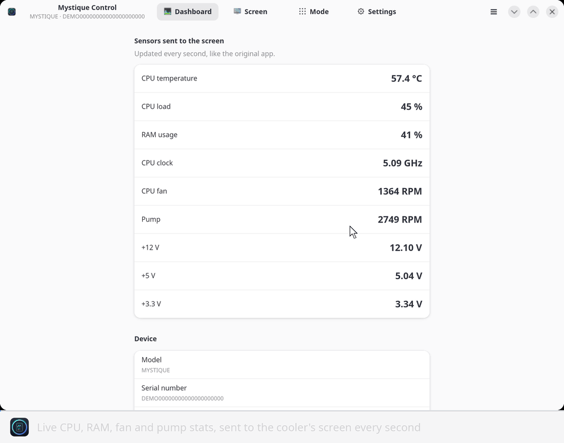
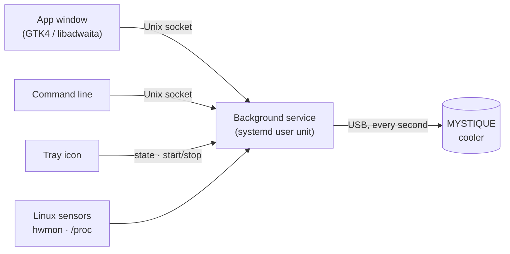
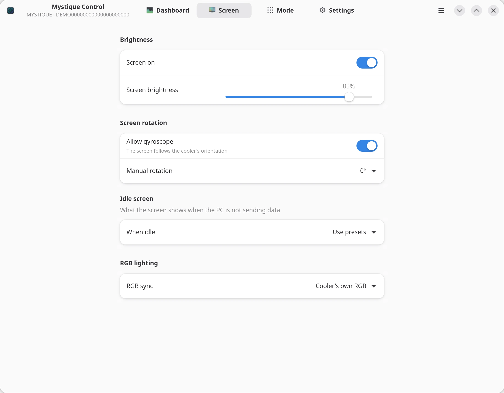
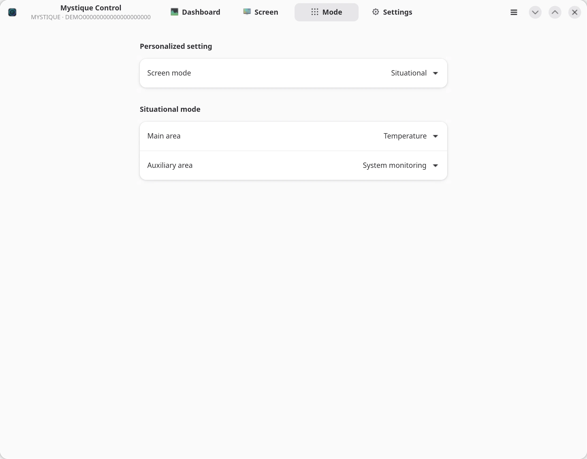
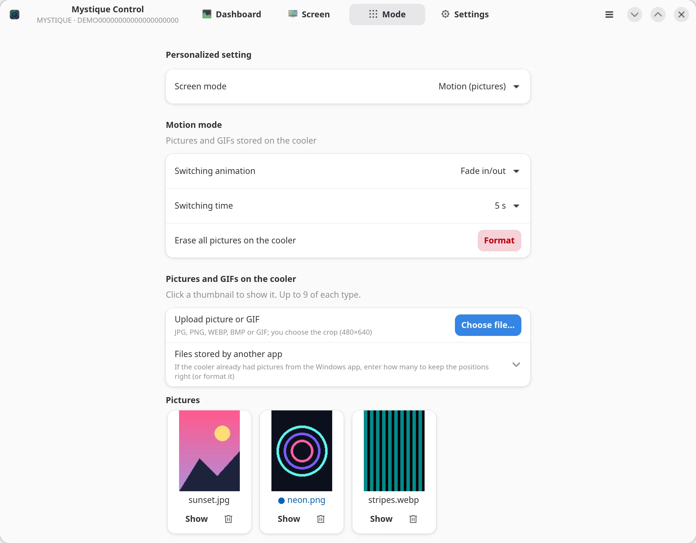
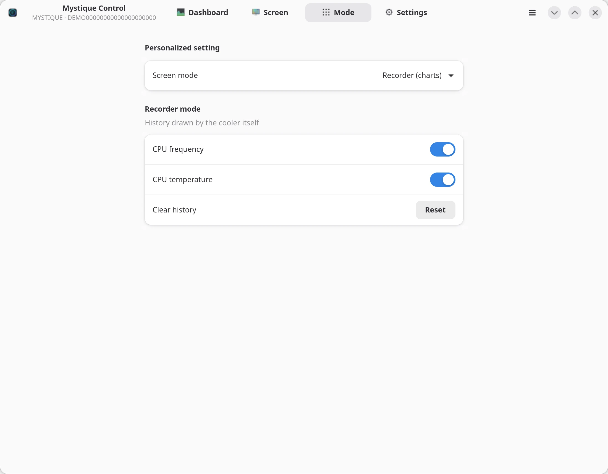
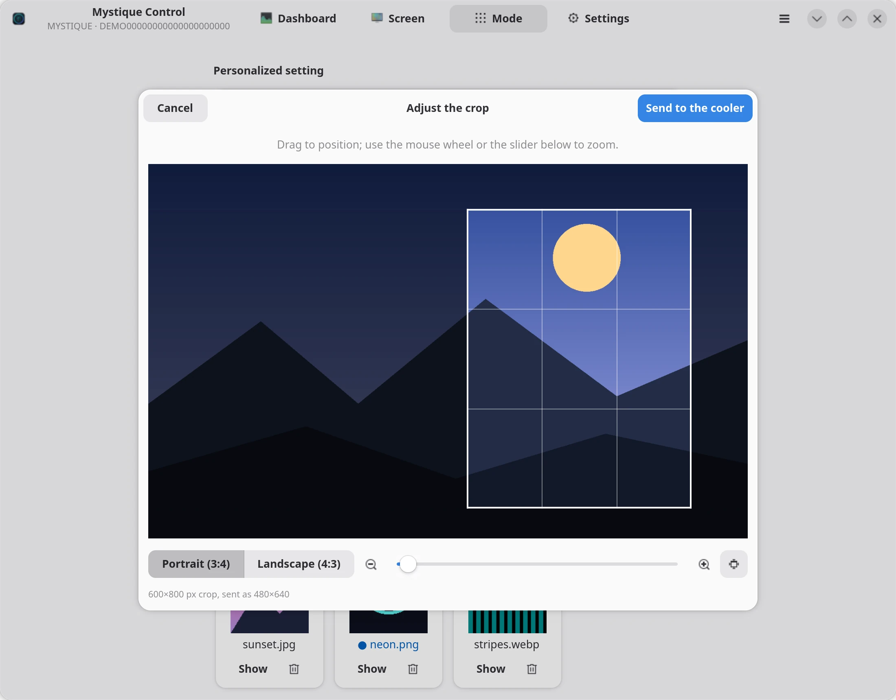
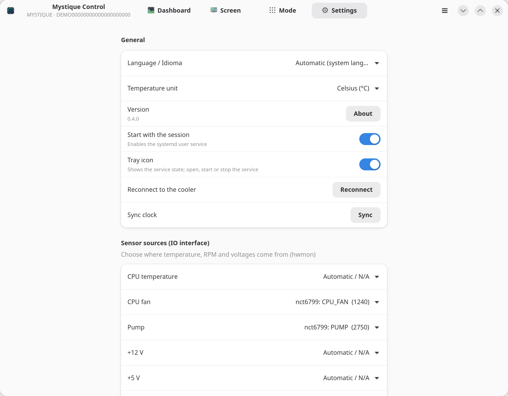
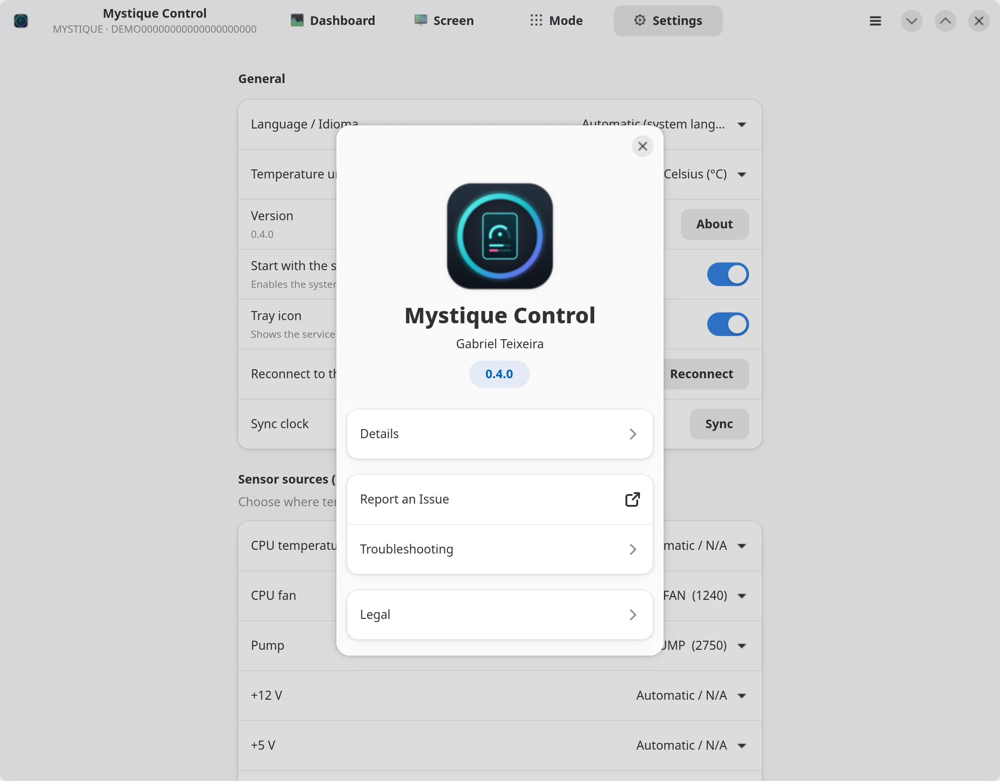

<p align="center"></p>

<h1 align="center">Mystique Control</h1>

<p align="center">
Unofficial native Linux app for the <b>DeepCool MYSTIQUE</b> AIO liquid cooler (USB <code>3633:0009</code>).<br>
App nativo (não oficial) para Linux do cooler <b>DeepCool MYSTIQUE</b>.
</p>

<p align="center">
<a href="https://github.com/gpteixeira/mystique-control/releases/latest"></a>


</p>

<p align="center">
<picture> <source media="(prefers-color-scheme: dark)" srcset="docs/demo/en-dark.gif">  </picture>
</p>

> Not affiliated with or endorsed by DeepCool.

## Download

**[⬇ Latest release (AppImage)](https://github.com/gpteixeira/mystique-control/releases/latest)**

```sh
chmod +x Mystique_Control-*-x86_64.AppImage
./Mystique_Control-*-x86_64.AppImage
```

**Verify the download** (recommended): download the matching `.sha256` file from the same
release into the same folder and run

```sh
sha256sum -c Mystique_Control-*-x86_64.AppImage.sha256
```

It must print `…AppImage: OK`. The SHA-256 is also shown in the release notes.

On the first start, click **"Allow access to the cooler"** to install the USB permission rule.
It asks for your password once. Turn on **"Start with the session"** in Settings to start the
background service with your session.

Tested on Ubuntu 24.04, Debian 13, Fedora 42, Arch Linux and openSUSE Tumbleweed (x86_64).
The AppImage updates itself through Gear Lever / AppImageUpdate.

## How it works



- **The background service** is the only program that talks to the cooler. When the cooler
  connects it sends your saved settings and syncs the cooler clock. After that it sends CPU
  temperature, load and clock, RAM usage, fan and pump speed and voltages every second, like
  the vendor app does on Windows.
- **The window and the command line** talk to the service. Every change is saved in
  `~/.config/deepcool-mystique` and applied right away.
- **The tray icon** shows whether the service is talking to the cooler, and lets you open the
  window or start/stop the service. It runs on its own, so it stays visible with the service stopped.
- **Pictures and GIFs** are cropped (you pick the area) and converted to 480×640 JPEG (each GIF
  frame becomes a JPEG) and stored in the cooler's memory.
- **No root needed** after the one-time USB permission rule (`70-deepcool-mystique.rules`).

## Tour

### Dashboard
What the cooler screen is showing right now, updated every second, plus the device details.

### Screen
Brightness, screen on/off, manual rotation or gyroscope, the idle screen and RGB sync.

<p align="center">
<picture> <source media="(prefers-color-scheme: dark)" srcset="docs/screenshots/en/dark/2-screen.webp">  </picture>
</p>

### Modes
The same three modes as the vendor app:

| Situational | Motion | Recorder |
|---|---|---|
| <picture> <source media="(prefers-color-scheme: dark)" srcset="docs/screenshots/en/dark/3-situational.webp">  </picture> | <picture> <source media="(prefers-color-scheme: dark)" srcset="docs/screenshots/en/dark/4-motion.webp">  </picture> | <picture> <source media="(prefers-color-scheme: dark)" srcset="docs/screenshots/en/dark/5-recorder.webp">  </picture> |
| Main area (CPU clock, time, pump, fan, temperature), style and auxiliary area | Upload pictures and GIFs (up to 9 of each), switching animation and time, choose what is shown | CPU clock and temperature charts drawn by the cooler |

### Crop
After picking a picture or GIF, drag the box over the part you want on the screen, zoom with the
mouse wheel or the slider and choose portrait (3:4) or landscape (4:3). You get a warning if the
crop is smaller than the screen (it would look blurry).

<p align="center">
<picture> <source media="(prefers-color-scheme: dark)" srcset="docs/screenshots/en/dark/8-crop.webp">  </picture>
</p>

### Tray icon
A system tray icon shows the state with a dot: **green** (service talking to the cooler),
**amber** (service running, no cooler) or **grey** (service stopped). Hover for the CPU
temperature and load; click to open the window; the menu has **Start/Stop the service**,
**Reconnect to the cooler** and **Close the tray icon**. Turn it on or off in Settings.
On GNOME it needs the AppIndicator extension (Ubuntu ships it).

### Settings and About
Language (English or Brazilian Portuguese), temperature unit, start with the session, tray icon, sensor
sources (CPU temperature, fan, pump, voltages), displayed names and the version. Menu ☰ →
**About** shows the version and copies troubleshooting details.

| Settings | About |
|---|---|
| <picture> <source media="(prefers-color-scheme: dark)" srcset="docs/screenshots/en/dark/6-settings.webp">  </picture> | <picture> <source media="(prefers-color-scheme: dark)" srcset="docs/screenshots/en/dark/7-about.webp">  </picture> |

## Command line

The AppImage is also a command line tool:

```sh
./Mystique_Control-*-x86_64.AppImage status            # device, sensors and settings (JSON)
./Mystique_Control-*-x86_64.AppImage set brightness 70
./Mystique_Control-*-x86_64.AppImage set mode situational   # situational | motion | recorder
./Mystique_Control-*-x86_64.AppImage upload picture.jpg     # or a .gif; [auto|vertical|horizontal] [x,y,w,h]
./Mystique_Control-*-x86_64.AppImage tray-enable       # tray icon with the session (tray-disable)
./Mystique_Control-*-x86_64.AppImage check             # why the cooler is (not) working
./Mystique_Control-*-x86_64.AppImage --version
./Mystique_Control-*-x86_64.AppImage --help            # everything else
```

## Notes

- Only one program can use the cooler at a time. Close the vendor app and other tools first,
  or stop a VM that has the cooler passed through.
- Fan/pump RPM and voltages come from the motherboard sensors (hwmon). If they show 0,
  load your board's Super I/O driver (for example `sudo modprobe nct6775`).

## Something not working?

Run `./Mystique_Control-*-x86_64.AppImage check`. It tells you the exact reason (missing USB
permission, cooler not found, USB busy, service stopped) and how to fix it.

Open an issue with your distro, the AppImage version and the output of `check` and `status`.

## License

MIT for Mystique Control. The AppImage bundles third-party libraries under their own
licences (see `THIRD-PARTY-NOTICES.txt` inside the AppImage).
